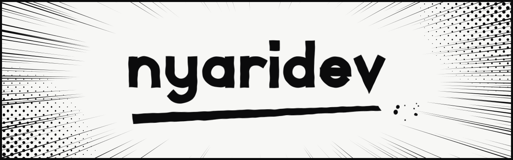
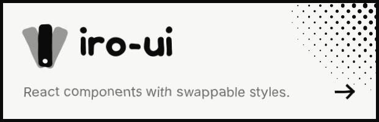
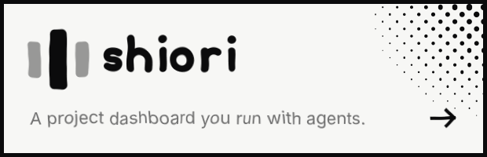
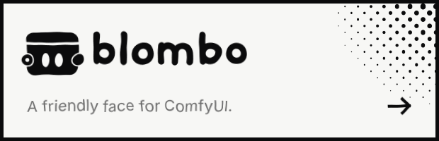
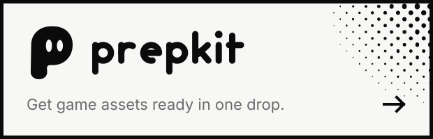

  <picture><source media="(prefers-color-scheme: dark)" srcset="assets/hero-dark.svg" /></picture> 
  <a href="https://github.com/nyaridev/iro-ui"><picture><source media="(prefers-color-scheme: dark)" srcset="assets/cards/iro-ui-dark.svg" /></picture></a>
  <a href="https://github.com/nyaridev/shiori"><picture><source media="(prefers-color-scheme: dark)" srcset="assets/cards/shiori-dark.svg" /></picture></a>
  <a href="https://github.com/nyaridev/BlomboUI"><picture><source media="(prefers-color-scheme: dark)" srcset="assets/cards/blomboui-dark.svg" /></picture></a>
  <a href="https://github.com/nyaridev/prepkit"><picture><source media="(prefers-color-scheme: dark)" srcset="assets/cards/prepkit-dark.svg" /></picture></a>

